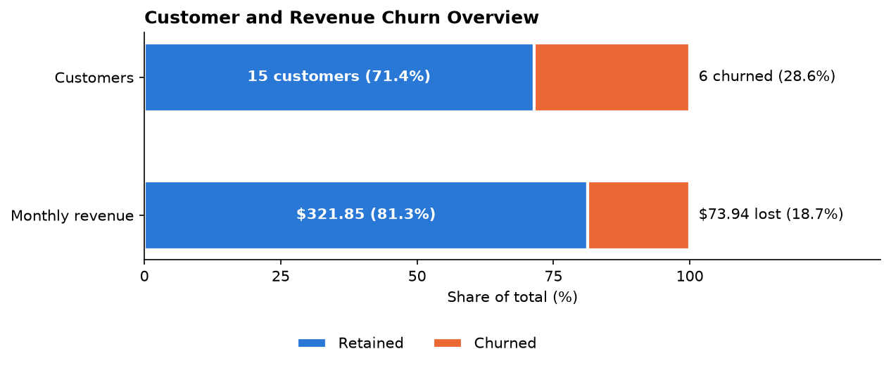
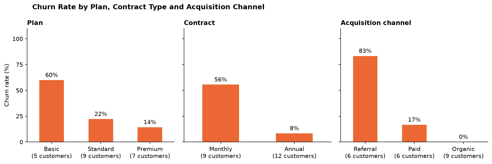
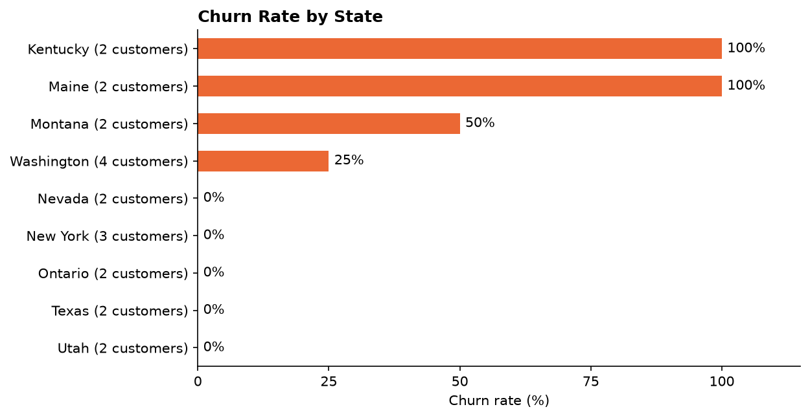
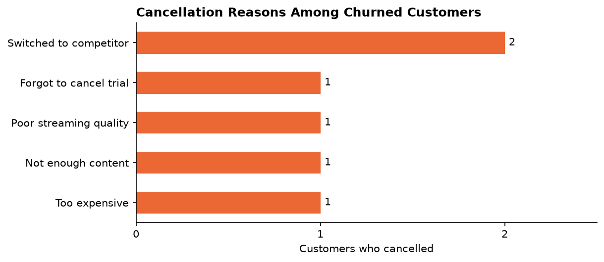
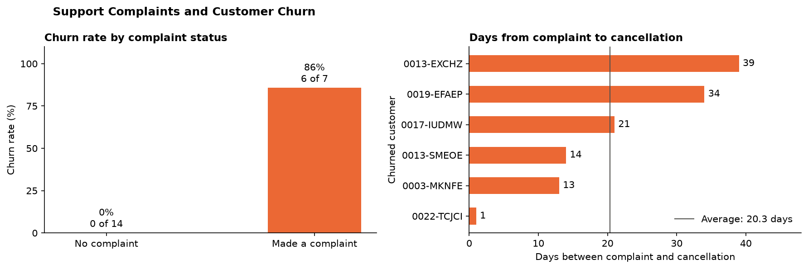
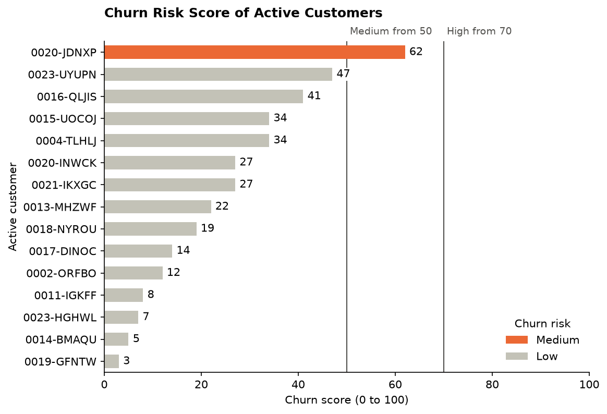
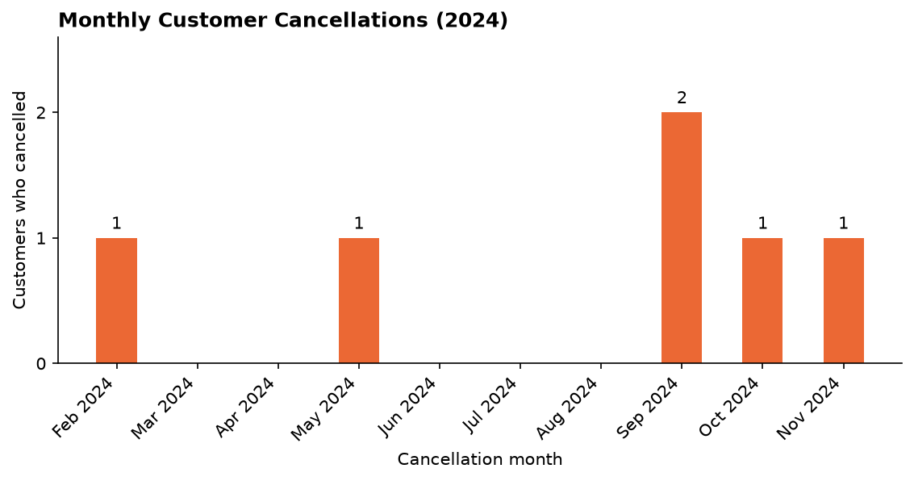

# Customer Churn Analysis for an OTT Platform

Why do subscribers of a streaming (OTT) service cancel, and which customers are most at risk of leaving next? This project loads customer, subscription and support data into SQL Server, cleans it, and analyses it in Python to find the drivers of churn.

> **Status: complete.** The notebook covers data import, cleaning, transformation, churn analysis and visualisation (see [Progress](#progress) and [Demo](#demo)), and the retention recommendations are under [Recommendations](#recommendations).
>
> **About the data:** the source is a synthetic dataset of 21 customers, created for practice. The project demonstrates an end-to-end analysis workflow; the figures and recommendations illustrate the method and are not evidence about a real business.

## Problem

An OTT platform loses a share of its subscribers every year. Each cancellation costs recurring revenue, and winning a new customer costs more than keeping an existing one. The business needs to know:

- How many customers churn, and how much monthly revenue goes with them?
- Which segments churn most (plan, contract type, acquisition channel, location)?
- What reasons do customers give for cancelling?
- Do support complaints, escalations and low satisfaction scores come before a cancellation?

## Data

The source data is synthetic: 21 customer records with their 21 subscriptions and 9 support records. It contains no real customer information.

| File | Contents |
| --- | --- |
| [Data/customer_churn_data_raw.xlsx](Data/customer_churn_data_raw.xlsx) | Raw source workbook (synthetic data) |
| [Data/OTT_customer_churn_db.sql](Data/OTT_customer_churn_db.sql) | SQL Server script that creates and populates `OTTCustomerChurnDB` |
| [Data/OTT_customer_churn_data.csv](Data/OTT_customer_churn_data.csv) | Cleaned and merged dataset exported by the notebook, one row per customer |

The database has three tables joined on `customerid`:

| Table | Rows | Key columns |
| --- | --- | --- |
| `db_customer` | 21 | name, country, state, gender, dob, interests |
| `db_subscription` | 21 | start and renewal dates, subscription type, plan type, contract type, cancellation date and reason, monthly charges, CLTV, churn score |
| `db_support` | 9 | complaint date, escalation flag, CSAT score, comment |

A customer counts as churned when `cancellation_date` is filled in. In the current data that is 6 of the 21 subscriptions.

The raw data is deliberately messy, and cleaning it is part of the project:

- Gender is coded inconsistently (`Male` / `Men`, `Female` / `Women`).
- Country is missing for three customers, stored as a mix of `NULL` and empty strings.
- Acquisition channel (`subscription_type`) contains a misspelling (`Refferal`).
- The subscription date columns arrive in pandas as generic objects, not datetimes.
- `pincode` is empty and `interests` is filled in for only 4 of 21 customers.
- `db_support` has an empty, unnamed column (`col_1`).

## Approach

1. **Load**: run the SQL script to build the database in SQL Server.
2. **Extract**: query the three tables from Python with SQLAlchemy and pyodbc.
3. **Clean**: standardise categories, handle missing values, fix data types.
4. **Transform**: derive a churn flag, customer tenure, complaints per customer and a churn risk band, then merge the three tables into one row per customer.
5. **Analyse**: measure churn, revenue and support metrics, and compare churn rates across segments.
6. **Visualise**: chart the findings with matplotlib and seaborn.
7. **Recommend**: turn the findings into retention actions.

## Progress

All seven steps are complete. Steps 1 to 6 are in the notebook, and step 7 is written up under [Recommendations](#recommendations).

### Importing data

- Connects to SQL Server through SQLAlchemy and pyodbc using Windows authentication.
- Discovers the tables from `sys.tables` and loads each one into its own DataFrame (`df_db_customer`, `df_db_subscription`, `df_db_support`).
- Lists every table's columns from `INFORMATION_SCHEMA.COLUMNS`. This is optional for three small tables, and the notebook explains when inspecting the schema first pays off on larger databases.

### Data cleaning

| Table | Issue | Fix applied |
| --- | --- | --- |
| `db_customer` | `interests` is mostly empty and `pincode` is entirely empty | Dropped both columns |
| `db_customer` | `name` is ambiguous once tables are joined | Renamed to `customer_name` |
| `db_customer` | Country missing for 3 customers, as `NULL` or an empty string | Trimmed whitespace and converted blanks to nulls, then filled each one from a state-to-country lookup built from the complete rows (Washington and Texas to USA, Ontario to Canada) |
| `db_customer` | Gender coded four ways | Standardised `Men` to `Male` and `Women` to `Female` |
| `db_subscription` | Start, renewal and cancellation dates loaded as objects | Converted to `datetime` |
| `db_subscription` | Acquisition channel misspelled as `Refferal` | Corrected to `Referral` |
| `db_support` | `col_1` is empty and `comment` is free text filled in for 4 of 9 rows | Dropped both columns |

The country fill relies on each state belonging to a single country, which holds for this dataset.

`cltv`, `churn_score` and `csat_score` are fully populated and are kept for the analysis.

### Transformations

- **Churn flag:** `churn_flag` is 1 when `cancellation_date` is filled in and 0 otherwise.
- **Merge:** subscription, customer and support data are joined on `customerid` into a single DataFrame, `df_merged`.
- **Duplicate rows resolved:** the first merge returned 23 rows for 21 customers, because two customers have two support records each. The notebook adds `num_complaints` (support records per customer), keeps one support record per customer, and merges again to get exactly 21 rows.
- **Export:** the merged dataset is saved to [Data/OTT_customer_churn_data.csv](Data/OTT_customer_churn_data.csv).
- **Tenure:** `tenure_days` runs from the subscription start date to the cancellation date, or to the day the notebook is run for customers who are still active.
- **Churn risk band:** `churn_risk` groups `churn_score` into Low (below 50), Medium (50 to 69) and High (70 and above).

### Data analysis

Headline metrics across the 21 customers:

| Metric | Result |
| --- | --- |
| Churn rate | 28.57% (6 of 21) |
| Retention rate | 71.43% |
| Average revenue per user (ARPU) | $18.85 a month |
| Monthly revenue lost to churned customers | $73.94 of $395.79 (about 19%) |
| Average customer tenure | About 1,557 days (roughly 4 years) at the last run |
| Escalation rate | 19.05% of customers (4 of 21) |
| Average complaints per user | 0.43 |
| Correlation between escalation and churn | 0.77 |
| Churn risk bands | 14 Low, 1 Medium, 6 High |

Churn rate by segment:

| Segment | Churn rate | Customers | Share of monthly revenue |
| --- | --- | --- | --- |
| Plan: Basic | 60.00% | 5 | |
| Plan: Standard | 22.22% | 9 | |
| Plan: Premium | 14.29% | 7 | |
| Channel: Referral | 83.33% | 6 | 18.93% |
| Channel: Paid | 16.67% | 6 | 44.20% |
| Channel: Organic | 0.00% | 9 | 36.87% |
| Contract: Monthly | 55.56% | 9 | 27.77% |
| Contract: Annual | 8.33% | 12 | 72.23% |

Reasons given by the six customers who cancelled:

| Cancellation reason | Customers | Share of churn | Monthly revenue lost |
| --- | --- | --- | --- |
| Switched to competitor | 2 | 33.33% | $25.98 |
| Forgot to cancel trial | 1 | 16.67% | $16.99 |
| Too expensive | 1 | 16.67% | $13.99 |
| Not enough content | 1 | 16.67% | $8.99 |
| Poor streaming quality | 1 | 16.67% | $7.99 |

Support history of churned and retained customers:

| Group | Customers | With a complaint | Average complaints | Average CSAT |
| --- | --- | --- | --- | --- |
| Churned | 6 | 6 | 1.33 | 29.17 |
| Retained | 15 | 1 | 0.07 | 90.00 |

Of the 7 customers who complained, 6 cancelled (85.71%). None of the 14 customers without a complaint cancelled. Each churned customer complained before cancelling, between 1 and 39 days earlier and 20.3 days on average.

Findings so far:

- **Referral is where the churn is.** 5 of the 6 cancellations come from Referral customers, and that channel contributes the smallest share of revenue.
- **Monthly contracts churn far more than Annual.** 5 of 9 Monthly customers cancelled against 1 of 12 Annual customers, and Annual contracts bring in about 72% of monthly revenue. The five Monthly churners are the same five Referral churners, so the two effects cannot be separated with this data.
- **No single cancellation reason dominates.** Switching to a competitor is the only reason given twice. The rest split between price or trial issues and content or streaming quality.
- **Cheaper plans churn more.** Basic has the highest churn rate and Premium the lowest.
- **Churn is concentrated geographically.** Kentucky and Maine lost every customer (2 of 2 each), while five of the nine states have no churn.
- **Churned customers are lower-paying.** They are 28.57% of customers but about 19% of monthly revenue.
- **A complaint is the clearest warning sign.** Every churned customer had complained first, and almost no retained customer had. The complaint came about 20 days before the cancellation on average, which is the window for a retention offer.
- **Churned customers were dissatisfied.** Their average CSAT is 29.17, against 90 for the one retained customer with a support record.
- **Escalations go with churn.** All four customers with an escalated support record cancelled.
- **The supplied churn score matches the outcome.** The six customers in the High risk band are the six who churned.

Limits to keep in mind:

- The data is synthetic and holds 21 customers. Most segments contain 2 to 9 people, so the rates are indicative only.
- Average tenure uses the run date for active customers, so it changes each time the notebook is run.
- Customers with two support records are represented by one of them, so CSAT and complaint dates reflect that single record.

How far the notebook answers the questions in [Problem](#problem):

| Question | Status | Answer so far |
| --- | --- | --- |
| How many customers churn, and how much monthly revenue goes with them? | Answered | 6 of 21 customers (28.57%), taking $73.94 of $395.79 in monthly revenue |
| Which segments churn most? | Answered | Referral channel, Monthly contracts and the Basic plan, with Kentucky and Maine the worst states |
| What reasons do customers give for cancelling? | Answered | Five reasons across six cancellations, led by switching to a competitor |
| Do support complaints, escalations and low satisfaction scores come before a cancellation? | Answered | Yes. All 6 churned customers complained 1 to 39 days before cancelling, their average CSAT is 29.17, and escalation is strongly linked to churn (correlation 0.77) |
| Which customers are most at risk of leaving next? | Answered | Of the 15 active customers, only `0020-JDNXP` (churn score 62) is in the Medium risk band and none are High. The next highest score is 47 |

### Visualisation

Section 5 of the notebook turns the analysis into seven charts, one for each question above, using matplotlib and seaborn. They are shown in [Demo](#demo).

- **One colour per meaning:** orange marks churn, blue marks retained customers and grey marks context, in every chart.
- **Values on the marks:** each bar carries its figure, and the segment charts show how many customers are behind each rate.
- **Insight with each chart:** every chart cell ends with a short written reading of the result.
- **Saved for reuse:** each chart is exported to the [images/](images/) folder when the notebook runs.

## Recommendations

Listed in priority order. The first has the strongest evidence and the lowest cost.

In the Reference column, analysis steps are the numbered cells in section 4 of the notebook (summarised under [Data analysis](#data-analysis)), and visuals are the charts in section 5 (shown in [Demo](#demo)).

| # | Action | Evidence from Analysis | Reference | How to measure success |
| --- | --- | --- | --- | --- |
| 1 | **Contact every customer within 7 days of a support complaint**, with a fix or a retention offer. Treat escalated complaints as urgent. | All 6 churned customers complained first; 6 of 7 complainers cancelled; none of the 14 without a complaint did. The gap was 20.3 days on average, and 13 days or more for 5 of the 6. | Analysis steps 16, 17 and 18; step 14 for escalations. Visual 5.5 | Churn rate among customers who complain, currently 86% |
| 2 | **Review the Referral programme.** Reward the referrer after the new customer's first renewal, not at sign-up, and add an onboarding check-in for referred customers. | Referral churn is 83% (5 of 6), against 17% for Paid and 0% for Organic. Referral brings 19% of revenue, and $60.95 of its $74.94 has already left. | Analysis step 4. Visual 5.2 | Referral churn rate; share of referred customers reaching first renewal |
| 3 | **Offer Monthly customers an incentive to switch to Annual.** Start with the four active Monthly customers. | Monthly churn is 56% against 8% for Annual. Annual contracts carry 72% of revenue. | Analysis step 6. Visual 5.2 | Number of Monthly customers converted; churn rate of converted customers |
| 4 | **Make a retention call to `0020-JDNXP` now**, and add `0023-UYUPN` to a watch list. | `0020-JDNXP` is the only active customer in the Medium band (score 62). `0023-UYUPN` (47) is just under the threshold and on a Monthly contract. | Analysis step 15. Visual 5.6 | Whether both customers are still active at next renewal |
| 5 | **Record the cause of every complaint and cancellation in fixed categories**, and re-run this analysis when there are more customers. | Six cancellations gave five different reasons, so no product fix can be prioritised yet. | Analysis step 11. Visual 5.4 | A dominant reason emerging once volume grows |

What is at stake: churn currently costs $73.94 a month, 18.7% of revenue. That is the upper limit on what these actions could recover.

What is not recommended from this data:

- **State-based campaigns.** Kentucky and Maine show 100% churn, but that is 2 customers each.
- **Price changes.** "Too expensive" was given once.
- **Choosing between actions 2 and 3 on evidence alone.** The five Referral churners are the same five Monthly churners, so the data cannot say which factor drives the loss. Both are worth trying, and a small test would separate them.

All of this rests on a synthetic dataset of 21 customers. The actions are cheap and reversible, which is why they are reasonable to try on thin evidence; anything expensive should wait for more data.

## Demo

The charts below are produced by section 5 of the notebook. The data is synthetic and holds 21 customers, so the rates are indicative only.

### How many customers churn, and how much revenue goes with them?



Six of 21 customers churned (28.6%), taking $73.94 of $395.79 in monthly revenue (18.7%). The revenue share lost is smaller than the customer share lost, so the customers who left were paying less than average.

### Which segments churn most?



Acquisition channel shows the widest gap: Referral 83%, Paid 17% and Organic 0%. Monthly contracts churn at 56% against 8% for Annual, and churn falls as the plan tier rises from Basic (60%) to Premium (14%). The same five customers are both Referral and Monthly, so those two effects overlap.



Kentucky and Maine lost every customer (2 of 2 each), which is 4 of the 6 cancellations. Five of the nine states have no churn.

### What reasons do customers give for cancelling?



Switching to a competitor is the only reason given twice. The other four reasons appear once each, covering price, trial, content and streaming quality.

### Do support complaints come before a cancellation?



Six of the 7 customers who complained went on to cancel (86%), and none of the 14 who never complained did. The complaint came 1 to 39 days before the cancellation, 20.3 days on average, which is the window for a retention offer.

### Which customers are most at risk of leaving next?



`0020-JDNXP` (score 62) is the only active customer above the Medium threshold and is the first candidate for a retention offer. No active customer is in the High band.

### When did customers cancel?



Four of the six cancellations fall between September and November 2024. Six events are too few to call this a seasonal pattern.

## How to run

**Requirements:** Python 3.14, SQL Server (with SSMS or `sqlcmd`), and ODBC Driver 17 for SQL Server.

1. Clone the repository.

   ```bash
   git clone https://github.com/SBundhunDev/Customer_Churn_Analysis.git
   cd Customer_Churn_Analysis
   ```

2. Create the database: open [Data/OTT_customer_churn_db.sql](Data/OTT_customer_churn_db.sql) in SSMS and execute it. The final query should report 21, 21 and 9 rows.

3. Create a virtual environment and install the dependencies.

   ```powershell
   python -m venv .venv
   .venv\Scripts\Activate.ps1
   pip install -r requirements.txt
   ```

4. Open [Notebook/OTT_Customer_Churn_Analysis.ipynb](Notebook/OTT_Customer_Churn_Analysis.ipynb) in VS Code or Jupyter and select the virtual environment as the kernel.

5. In the connection cell, set `server` to your own SQL Server instance name (the one shown in the SSMS connect dialog, for example `MYPC\SQLEXPRESS`). The notebook connects with Windows authentication, so no username or password is needed.

6. Run all cells.

The notebook reads from the database, not from the script. If you edit the data in [Data/OTT_customer_churn_db.sql](Data/OTT_customer_churn_db.sql), execute the script again in SSMS and then re-run the notebook to see the change.

## Project structure

```
Customer_Churn_Analysis/
├── Data/
│   ├── customer_churn_data_raw.xlsx
│   ├── OTT_customer_churn_data.csv
│   └── OTT_customer_churn_db.sql
├── images/
│   ├── cancellation_reasons.png
│   ├── churn_by_segment.png
│   ├── churn_by_state.png
│   ├── churn_overview.png
│   ├── churn_risk_active_customer.png
│   ├── complaints_churn.png
│   └── monthly_cancellation.png
├── Notebook/
│   └── OTT_Customer_Churn_Analysis.ipynb
├── LICENSE
├── README.md
└── requirements.txt
```

## Tech stack

Python · pandas · NumPy · matplotlib · seaborn · SQLAlchemy · pyodbc · SQL Server · Jupyter

## License

Released under the [MIT License](LICENSE).
